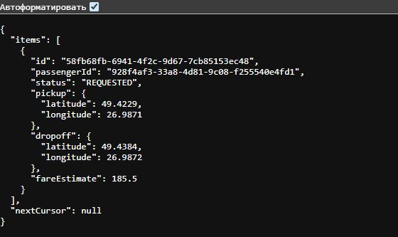

# Звіт про виконання лабораторної роботи №3

Тема: Проєктування та специфікація API міжмодульної та міжсервісної взаємодії (REST OpenAPI 3.0 та gRPC Protocol Buffers) (MILESTONE 3)

Хід роботи

## 1. Контракти API

Для клієнтських застосунків описано REST API поїздок у `api/openapi.yaml`. Контракт вручну створено за підходом Contract-First. Він містить методи `GET` і `POST` для списку поїздок, `GET` і `DELETE` для окремої поїздки та `PATCH` для зміни стану. У запитах використані параметри шляху, фільтр за станом, обмеження кількості результатів і курсор сторінки. Схеми перевіряють UUID, координати та суму.

Помилки описані схемою Problem Details з типом `application/problem+json`. У контракті наведені відповіді 400, 401, 404 і 422.

Для внутрішнього зв'язку сервісів описано gRPC-контракт у `api/service.proto`. Він містить методи створення і пошуку поїздки та потоковий метод `WatchTripStatus`. Стани задані enum, координати вкладені в повідомлення, час має тип Timestamp.

## 2. Перевірка Prism Mock Server

Mock-сервер запущено за `api/openapi.yaml` з перевіркою відповідності запитів контракту. Виконано три запити:

| Запит | Результат |
|---|---|
| `POST /trips` з коректними даними | 201 Created |
| `POST /trips` з неправильним UUID, координатою та сумою | 422 Problem Details |
| `GET /trips?status=REQUESTED&limit=5&cursor=next-page` | 200 OK |

У відповіді GET-запиту видно статус поїздки REQUESTED, координати початку й завершення та вартість.

Контракт додатково перевірено через Spectral.

## 3. Розмір повідомлень

Для порівняння взято однакову відповідь з ідентифікаторами, станом, координатами, сумою і часом створення. Розмір пораховано для UTF-8 JSON та серіалізованого повідомлення Protocol Buffers:

| Формат | Розмір |
|---|---:|
| JSON | 299 байт |
| Protobuf | 135 байт |

За наведеними даними, Protobuf приблизно у 2,2 раза компактніший за JSON. JSON зручніше читати вручну, бо в ньому видно назви полів. У Protobuf кожне поле має окремий номер, тому номер видаленого поля не використовують повторно. HTTP/2 дає змогу передавати кілька потоків через одне з’єднання. gRPC використовує цю можливість, а REST API також може працювати через HTTP/2.

## 4. Згенеровані файли

За файлом `api/service.proto` згенеровано C#-класи повідомлень і заготовки методів сервісу в `api/generated/csharp/`.

## Контрольні питання

1. У чому полягають фундаментальні переваги підходу Contract-First над Code-First при проєктуванні мікросервісних систем?

Команди спочатку узгоджують формат запитів і відповідей. Клієнтську та серверну частини можна робити паралельно, не прив'язуючи зовнішній контракт до внутрішнього коду.

2. Яким чином Protocol Buffers досягає високої компактності бінарних даних (кодування Varint, тегування ключів)?

У повідомленні передаються короткі номери полів і значення, а не довгі назви полів. Цілі числа часто кодуються Varint, тому для невеликих значень потрібно менше байтів.

3. Чому в синтаксисі Proto3 відмовилися від ключових слів required та які правила додавання/видалення полів гарантують зворотну сумісність?

У Proto3 поля можуть бути відсутні, тому обов'язковість перевіряє програма. Для сумісності не можна повторно використовувати номер видаленого поля. Нові поля додають з новими номерами, а старі клієнти їх ігнорують.

4. Які поля є обов'язковими у структурі опису помилок стандарту RFC 7807 (Problem Details) і чому повернення простого рядка `{ "error": "text" }` є антипатерном?

У RFC 7807 поля `type`, `title`, `status`, `detail` та `instance` є стандартними, але необов'язковими. У нашій схемі обов'язкові `type`, `title` і `status`. Простий рядок не дає клієнту сталих полів для обробки помилок.

5. Чим транспортний шар HTTP/2 у gRPC кардинально відрізняється від HTTP/1.1 у класичному REST (мультиплексування потоків, стиснення заголовків HPACK)?

HTTP/2 передає кілька потоків в одному з'єднанні та стискає заголовки через HPACK. Це зменшує повторні витрати при частих викликах. REST теж може працювати через HTTP/2, але gRPC використовує його для RPC-викликів і потокової передачі.

Висновок: під час роботи я навчився описувати REST API та gRPC-контракт і перевіряти REST-запити через мок-сервер. Я порівняв розмір однакових даних у JSON і Protobuf та побачив, коли зручніше використовувати кожен формат.
