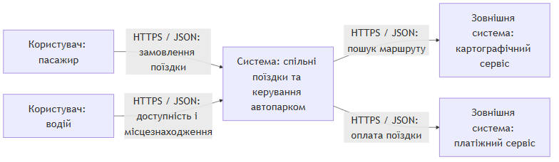
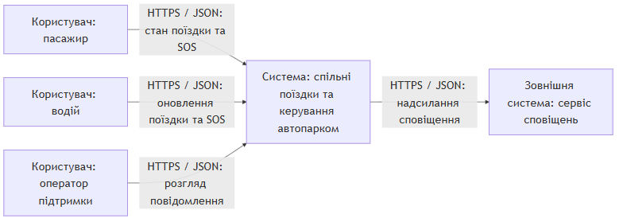
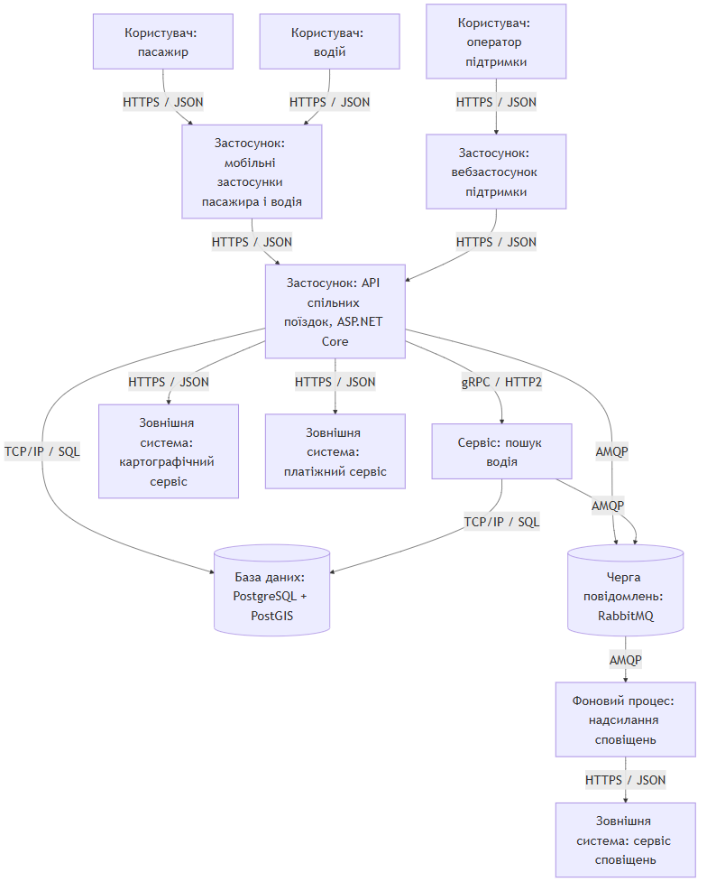
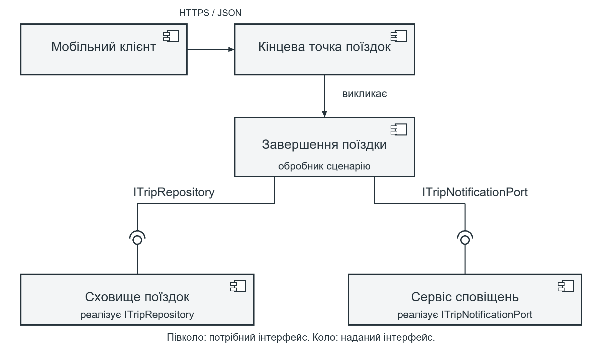
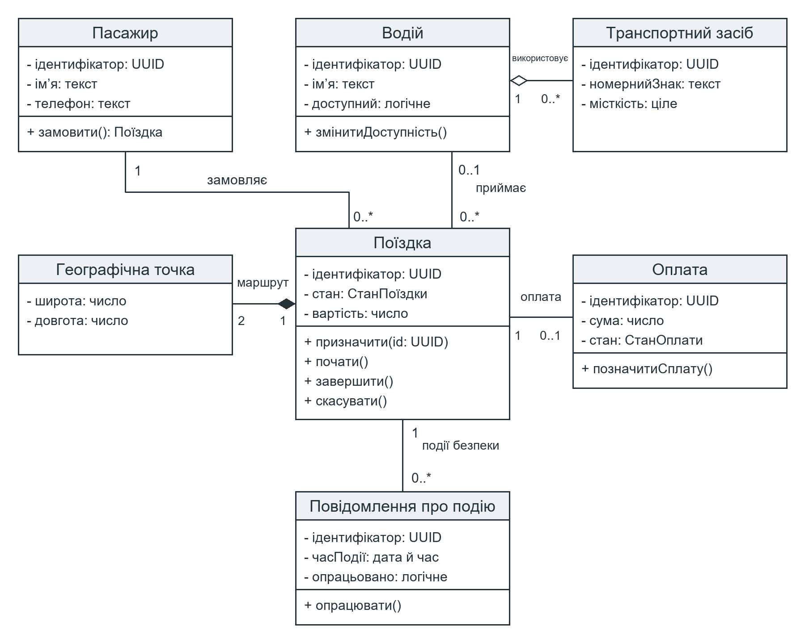
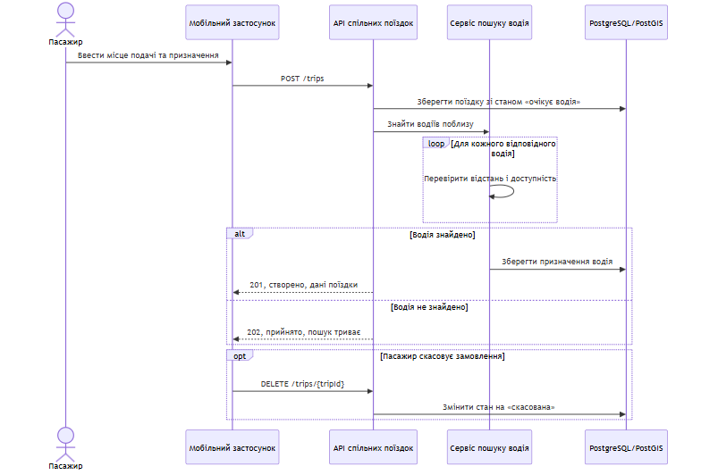
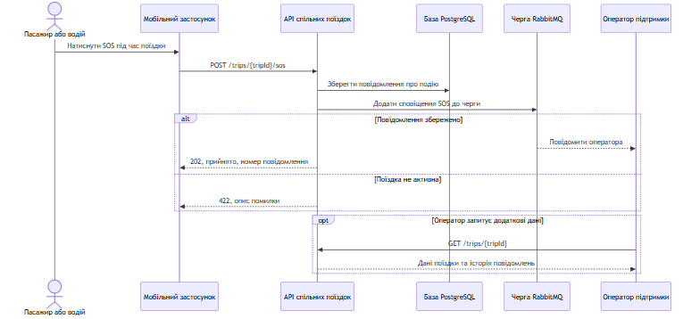
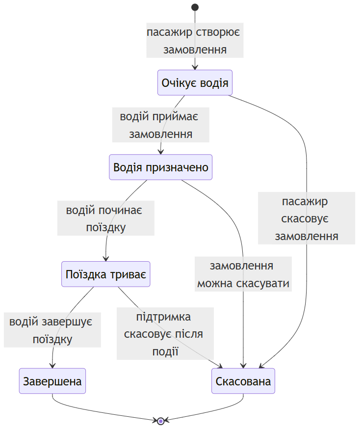

# Звіт про виконання лабораторної роботи №2

Тема: Побудова C4 Model, UML-моделювання статичної структури та динаміки поведінки (MILESTONE 2)

Git-тег: `lr2`. Репозиторій: https://github.com/rxcGG/ride-sharing-fleet-management

Хід роботи

Варіант № 6

## 1. C4 Model

У системі є два основні контексти: замовлення поїздки та безпека під час поїздки. Пасажир і водій працюють через мобільний застосунок. Оператор підтримки переглядає звернення. Система обмінюється даними з картографічним, платіжним і сервісом сповіщень.

### Контекст замовлення поїздки

Застосунок передає запит до сервісу поїздок. Сервіс перевіряє маршрут у картографічного провайдера та надсилає платіж провайдеру після поїздки.

### Контекст безпеки поїздки

Пасажир або водій можуть повідомити про небезпеку. Система передає сповіщення зовнішньому провайдеру, а оператор підтримки перевіряє інцидент.

---PAGEBREAK---

### Контейнери та протоколи

Застосунки та зовнішні сервіси звертаються до API через HTTPS/JSON. Внутрішній сервіс призначення водія використовує gRPC. Сповіщення передаються через брокер повідомлень за AMQP. Сервіси та база даних працюють у мережі TCP/IP.

## 2. UML-діаграми структури

### Компоненти сервісу поїздок

Клієнт звертається до API, а сценарій завершення поїздки використовує два потрібні інтерфейси. Сховище і сервіс сповіщень надають ці інтерфейси. На рисунку показано їхні UML-обозначення: socket для потрібного інтерфейсу та кружок для наданого.

### Класи предметної області

У моделі показано пасажира, водія, транспорт, поїздку, оплату та інцидент безпеки. Для поїздки та оплати наведені стани, а зв'язки мають вказану кратність. Географічна точка використовується як складова поїздки.

## 3. UML-діаграми поведінки

### Створення поїздки

Сервіс шукає водіїв поблизу циклом. Фрагмент `alt` показує результат пошуку з водієм або без нього. Фрагмент `opt` показує скасування запиту пасажиром.

### Повідомлення про небезпеку

Система зберігає повідомлення і надсилає його оператору через брокер. Умова `alt` відрізняє успішне збереження від випадку, коли поїздка вже не активна. Фрагмент `opt` показує додатковий запит оператора.

### Життєвий цикл поїздки

Після створення поїздка очікує водія, далі може перейти до виконання, завершитися або бути скасованою. Завершену поїздку скасувати не можна.

## Контрольні питання

1. У чому полягають фундаментальні відмінності між нотацією C4 Model та класичним стандартом UML 2.5?

C4 показує систему на кількох рівнях збільшення: від контексту до компонентів. UML має різні формальні діаграми для структури та поведінки системи.

2. Яким чином на C4 Container Diagram відображаються виклики між синхронними (REST/gRPC) та асинхронними (AMQP/Kafka) контейнерами?

Для синхронного виклику контейнер чекає відповідь, наприклад через REST або gRPC. За AMQP повідомлення надсилається брокеру, а одержувач обробляє його пізніше.

3. Що означають поняття Provided («Ball») та Required («Socket») інтерфейсів на діаграмі компонентів UML?

Provided означає, що компонент надає операцію іншим. Required означає, що компонент потребує операцію від іншого компонента.

4. У чому відмінність між агрегацією та композицією на діаграмі класів? Наведіть приклад з вашої доменної моделі.

За композиції частина залежить від цілого. Наприклад, координати початку маршруту є частиною поїздки. За агрегації об'єкт може існувати окремо, наприклад водій і транспорт.

5. Як на діаграмі послідовностей (Sequence Diagram) моделюється умовне виконання (alt vs opt) та циклічна обробка (loop)?

`alt` показує кілька взаємовиключних варіантів, а `opt` один необов'язковий крок. `loop` показує повторення дій, наприклад перевірку кількох водіїв.

Висновок: у роботі побудовано діаграми системи поїздок і показано її основні частини та сценарії. Я закріпив різницю між загальним описом системи, її структурами та послідовністю дій.
